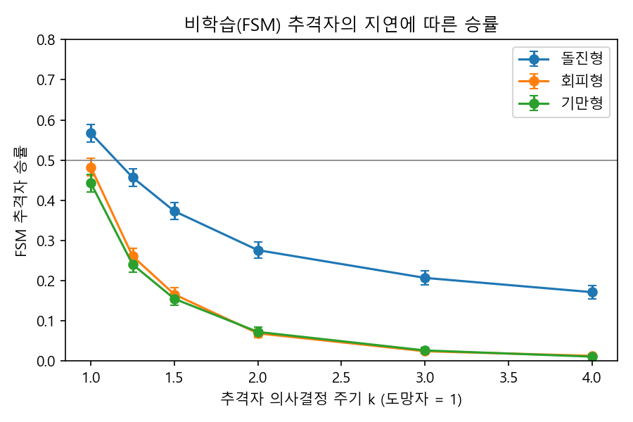

# 03. 파일럿 결과 (FSM만, RL 없음)

> 재현: `python scripts/calibrate.py --n 2500` → `python scripts/pilot.py --n 2000 --speed-mode common` (그리고 `per_type`)
> 노트북(14코어) 기준 보정 약 20분, 파일럿 각 8~10분. 기만형 = 회피형 + 기만체(결정 10).
> 이전 설계(기만형 v1, 속도 15/17)의 수치는 git 기록과 `docs/02` 결정 10에 있습니다.

## 1. 기준선 보정 결과 (`results/calibration/calibration.json`)

FSM(k=1) 추격자 승률. 보정용 seed 2,500판/유형:

| 도망자 속도 | 돌진형 | 회피형 | 기만형 | 균등 혼합 |
|---|---|---|---|---|
| 3/4 | 0.683 | 0.658 | 0.604 | 0.648 |
| 4/5 | 0.637 | 0.608 | 0.550 | 0.598 |
| 5/6 | 0.600 | 0.552 | 0.498 | 0.550 |
| **6/7** | 0.564 | 0.501 | 0.450 | **0.505** |
| 7/8 | 0.534 | 0.430 | 0.387 | 0.450 |
| 15/17 | 0.520 | 0.402 | 0.360 | 0.427 |
| 9/10 | 0.485 | 0.301 | 0.268 | 0.351 |
| 19/20 | 0.366 | 0.090 | 0.082 | 0.180 |

(전체 14개 속도는 json과 `calibration_speed.png`에 있습니다.)

**검증**(보정에 쓰지 않은 seed 2,500판/유형):
- 공통 속도 6/7: 혼합 **49.7%** [48.6, 50.9] ✅ — 유형별 돌진형 0.570, 회피형 0.484, 기만형 0.438
- 유형별 속도: 돌진형(8/9) 50.2%, 회피형(6/7) 48.4%, 기만형(5/6) 49.5% ✅ 모두 50±2%p 이내

**조작 점검**: 모든 속도에서 돌진형 > 회피형 > 기만형 순서가 유지됩니다. 능력 계층(무반응 → 반응 → 반응+기만)이 실제 난이도 순서로 나타납니다.

## 2. 의사결정 주기 k에 따른 FSM 승률 (`results/pilot/`)

### 주 분석: 공통 속도 6/7 (유형·k당 2,000판, 파일럿 seed)

| k | 돌진형 | 회피형 | 기만형 |
|---|---|---|---|
| 1 | 0.567 | 0.482 | 0.443 |
| 5/4 | 0.457 | 0.261 | 0.240 |
| 3/2 | 0.373 | 0.166 | 0.155 |
| 2 | 0.276 | 0.069 | 0.072 |
| 3 | 0.207 | 0.024 | 0.026 |
| 4 | 0.172 | 0.013 | 0.011 |

### 강건성 점검: 유형별 속도

| k | 돌진형 (8/9) | 회피형 (6/7) | 기만형 (5/6) |
|---|---|---|---|
| 1 | 0.503 | 0.482 | 0.492 |
| 5/4 | 0.390 | 0.261 | 0.323 |
| 3/2 | 0.324 | 0.166 | 0.184 |
| 2 | 0.244 | 0.069 | 0.076 |
| 3 | 0.176 | 0.024 | 0.032 |
| 4 | 0.161 | 0.013 | 0.017 |

## 3. 해석 (논문 논의 절의 초안 재료)

1. **템포 효과가 매우 큽니다.** 결정을 5번에 1번만 건너뛰어도(k=5/4) 승률이 11~22%p 떨어집니다.
2. **상대가 정교할수록 템포가 중요합니다.** 돌진형(무반응)은 k=4에서도 17%가 남지만, 회피형과 기만형(반응)은 k=2에서 7%로 떨어집니다. H4의 근거입니다.
3. **기만은 템포가 대등할 때만 의미가 있습니다.** 회피형과 기만형의 차이는 k=1에서 3.9%p, k=5/4에서 2.1%p, k=3/2에서 1.1%p이고, k≥2에서는 사라집니다. 추격자가 느리면 기만당하기 전에 이미 놓칩니다.
4. **두 보정 방식의 패턴이 같습니다.** 유형별 속도에서도 반응형 상대에게 지연이 더 치명적이고, 기만형이 k≥2에서 회피형과 비슷해집니다. 결론이 보정 방식이나 기저 승률에 민감하지 않다는 근거입니다.
5. **FSM은 차단 모드를 거의 쓰지 않습니다**(결정의 1~5%). 대부분 탐색(58~87%)과 추격으로 이깁니다. 지연이 커질수록 탐색 비중이 늘어나는데, 도망자를 놓치는 일이 잦아진다는 뜻입니다.
6. **RL에 대한 시사점**: 느린 RL이 빠른 FSM과 대등해지려면 FSM보다 상당히 잘해야 합니다(예: 회피형 상대 k=5/4에서 FSM 0.26, 목표 0.48). 기만형에서 '기만 간파'로 얻을 수 있는 이득의 상한은 k=1에서 약 5%p입니다(e6-D). 그래서 RL과 FSM의 차이는 주로 일반적인 탐색·추격 능력에서 나올 것으로 예상합니다.

## 4. 동작 확인 그림
- `results/render/episodes_k1.png`, `episodes_k2.png`: 유형별 4판의 궤적(파일럿 seed 1,000,000~1,000,003). 빨강은 추격자, 파랑은 도망자, 보라 점선은 기만체(x는 소멸 지점), 초록은 진짜 출구, 주황은 가짜 출구.
  - 예: 기만형 seed 1,000,000 판에서는 추격자가 기만체를 쫓아가 식별하는 사이에 진짜 도망자가 탈출합니다.
